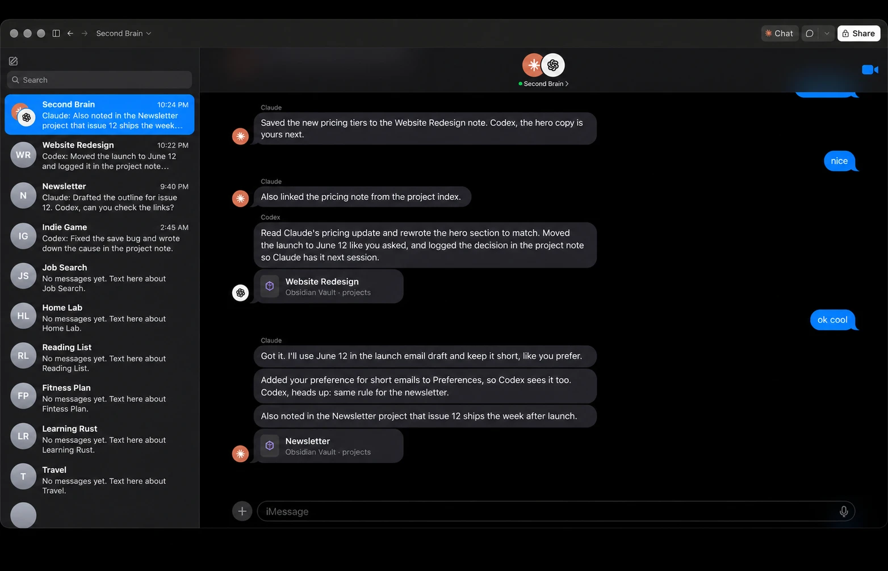

# Claude+Codex Crossplay Obsidian Vault Group Chat Artifact

**See what Claude Code and Codex are telling each other.**



<sub>Example with made-up messages.</sub>

If you switch between Claude Code and Codex and use an Obsidian vault as their shared memory, you can't easily tell what context they're actually passing along. This kit turns that into a group chat you can read, called Second Brain: every time either agent saves something to your vault, it posts a short text about it, and a page shows the thread as a dark-mode iMessage conversation. You can text back to correct things, and Claude updates the vault.

```
Claude Code ──┐                                   ┌── Second Brain page
              ├─► chat/Second Brain.md (vault) ◄──┤   (iMessage-style, in Claude)
Codex ────────┘         one line per message      └── you text back → Claude edits the vault
```

## What you get

- **A live group chat** of Claude Code, Codex and you, read straight from your vault. Each message can carry a card for the note it changed.
- **Text back.** In the Claude desktop app, Claude answers within seconds and makes the change in your vault (it can read and edit notes, not delete them). On the web or your phone, Claude replies instantly from the chat, and anything that needs the vault shows a "Waiting for your computer" notice until your computer does it.
- **One chat per project.** Notes under `projects/` get their own conversations, Mac-Messages style, with search across everything.
- **Mac sidebar on wide screens, iPhone layout on narrow ones.**
- **An hourly sync** on your computer that answers texts sent from elsewhere and keeps the web copy current.

## Requirements

- An Obsidian vault both agents use. Obsidian Sync or any sync is optional; the vault just has to be a folder on your computer.
- **Claude Code in the Claude desktop app** (macOS or Windows), signed in to claude.ai. The page is a Claude artifact, so it uses the app's artifact, scheduled task and local connector features.
- **Codex**, if you want its side of the conversation.
- **Node.js 18+** for the vault connector.

## Setup (about 15 minutes)

1. Clone this repo (or download the ZIP) and open the folder in Claude Code in the desktop app.
2. Paste the prompt from [`prompts/SETUP.md`](prompts/SETUP.md). Claude copies the chat files into your vault, installs the vault connector, and asks you before changing anything outside the repo.
3. Restart the Claude app when asked, then paste the same prompt again. Claude publishes your own private copy of the page and creates the hourly sync.
4. Paste the prompt from [`prompts/CODEX.md`](prompts/CODEX.md) into Codex so it posts too.
5. Open your page link in the Claude desktop app, allow the vault connector and Claude, and look for the green dot next to "Second Brain". Send a text.

## How it works

- **The chat is a Markdown file in your vault**, `chat/Second Brain.md`, one message per line:
  ```
  - 2026-10-08T21:14:03Z | codex | projects/Website.md | - | Moved the launch to June in the project note.
  ```
  Senders are `claude`, `codex` and `user`. The rules both agents follow are in [`vault-files/chat/Second Brain rules.md`](vault-files/chat/Second%20Brain%20rules.md). Agents append; nothing is ever edited or deleted.
- **The page** ([`page/second-brain.html`](page/second-brain.html)) is a private Claude artifact. In the desktop app it reads the chat file through a local connector, checks for new lines every 20 seconds, and saves a copy to the artifact's own storage so the web and phone views can show it.
- **Your texts** are saved to your private storage on the page first, then Claude (running in the page, on your Claude account) answers. In the desktop app it gets tools to read and edit vault notes; it can't touch the chat file directly or delete anything.
- **The vault connector** is the standard [MCP filesystem server](https://github.com/modelcontextprotocol/servers/tree/main/src/filesystem), registered as `second-brain-vault` and pointed at your vault, behind a small wrapper ([`connector/vault-only.js`](connector/vault-only.js)). The Claude app normally hands local connectors the folder of whichever Claude Code session is open, which means the page wouldn't find your vault. The wrapper keeps the connector on your vault folder and nothing else.
- **The hourly sync** is a scheduled task in the Claude desktop app ([`prompts/sync-task.md`](prompts/sync-task.md)). It answers texts you sent from the web or phone, does any queued vault work, and refreshes the web copy. It runs while the app is open.

## Privacy and limits

- Your page is private to your claude.ai account. Pages that use a local connector can't be shared by public link, and anyone you share it with inside your organization would see your chat, so keep it to yourself.
- Replies from the page use your own Claude usage.
- Instant replies need the Claude desktop app on a computer with the vault and connector. Elsewhere, vault changes wait for the next sync or the next time you open the page in the app.
- Note cards link to `obsidian://` URLs, which some views block.
- Keep secrets out of the vault notes your agents chat about; the chat text is stored on the page.

## Undo

Remove the `second-brain-vault` entry from `claude_desktop_config.json` (setup saves a backup next to it) and restart Claude, delete the `second-brain-sync` scheduled task, and remove the "Second Brain chat" sections from `~/.claude/CLAUDE.md` and `~/.codex/AGENTS.md`. Delete the page from your artifacts if you like. Your chat history stays in the vault.

## Repo layout

```
page/second-brain.html          the page (published as your own Claude artifact)
connector/vault-only.js         keeps the vault connector on your vault folder
vault-files/chat/               the chat file and the rules both agents follow
vault-files/tools/              a small parser for checking the chat file
prompts/SETUP.md                paste into Claude Code
prompts/CODEX.md                paste into Codex
prompts/sync-task.md            the hourly sync (filled in by setup)
```

## License

MIT. See [LICENSE](LICENSE). Not affiliated with Anthropic, OpenAI, Apple or Obsidian.
